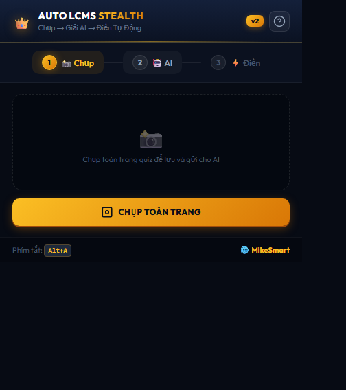
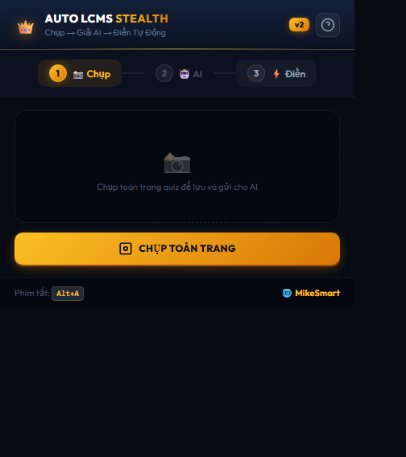

# 👑 CẨM NANG HƯỚNG DẪN CÀI ĐẶT & SỬ DỤNG AUTO LCMS (CHO SINH VIÊN)
### Dành cho sinh viên thi trắc nghiệm trên hệ thống LCMS Moodle (`lcms.ntt.edu.vn`)

> **Phiên bản**: v2.2.0 Stealth Luxury Edition  
> **Tác giả**: [MikeSmart Studio](https://mikesmart.vercel.app/)  
> **Cam kết cốt lõi**: **Tự động hóa 100% — Tàng hình tuyệt đối trước giám thị — Khóa an toàn KHÔNG BAO GIỜ tự nộp bài.**

---

## 📑 MỤC LỤC NHANH
1. [Tại sao sinh viên nên dùng Auto LCMS?](#1-tại-sao-sinh-viên-nên-dùng-auto-lcms)
2. [Hướng dẫn cài đặt lên trình duyệt (Chỉ mất 30 giây)](#2-hướng-dẫn-cài-đặt-lên-trình-duyệt-chỉ-mất-30-giây)
3. [Quy trình làm bài chuẩn SOP 10/2026 (6 bước khép kín)](#3-quy-trình-làm-bài-chuẩn-sop-102026-6-bước-khép-kín)
   - [Cách 1: Giải 1-Click Siêu Tốc bằng Gemini AI Auto-Solver (Khuyên dùng)](#cách-1-giải-1-click-siêu-tốc-bằng-gemini-ai-auto-solver-khuyên-dùng)
   - [Cách 2: Chụp ảnh toàn bài & Gửi Web AI (Gemini, Claude, ChatGPT, DeepSeek)](#cách-2-chụp-ảnh-toàn-bài--gửi-web-ai)
4. [Bí kíp sử dụng Bảng Điều Khiển Tàng Hình On-Page (Phím tắt Alt+A)](#4-bí-kíp-sử-dụng-bảng-điều-khiển-tàng-hình-on-page-phím-tắt-alta)
5. [Cách đối chiếu đáp án với Bảng Soát Lại (Review Matrix)](#5-cách-đối-chiếu-đáp-án-với-bảng-soát-lại-review-matrix)
6. [Mẹo xử lý bài thi nhiều trang (Multi-page Quiz)](#6-mẹo-xử-lý-bài-thi-nhiều-trang-multi-page-quiz)
7. [Giải đáp các câu hỏi thường gặp (FAQ)](#7-giải-đáp-các-câu-hỏi-thường-gặp-faq)

---

## 1. TẠI SAO SINH VIÊN NÊN DÙNG AUTO LCMS?

| Tính năng thông thường | Auto LCMS Stealth Luxury v2.2.0 | Lợi ích cho sinh viên |
| :--- | :--- | :--- |
| **Chụp ảnh màn hình thủ công** | Chụp cuộn tự động Pixel Stitch xuất PNG / JPG / PDF A4 đa trang (tự chia trang thông minh, không cắt ngang câu hỏi) | Không lo ảnh bị thiếu câu, PDF in ra sắc nét chuẩn A4 |
| **Đề thi bị xáo trộn A, B, C, D** | Đối chiếu nguyên văn xâu ký tự (Kháng đảo đề 100%) | Dù trường có tráo đáp án vị trí nào cũng chọn đúng |
| **Điền tay từng câu mất thời gian** | Động cơ điền 2 tốc độ: Siêu tốc 0.02s hoặc Giả lập người thật | Tiết kiệm 95% thời gian làm bài, tránh áp lực tâm lý |
| **Sợ bị trừ điểm do gian lận** | Công nghệ Closed Shadow DOM, Focus Spoof | Script theo dõi của trường **hoàn toàn không thấy** tool |
| **Sợ tool tự động nộp bài sai** | **Khóa an toàn 100%**: Dừng hẳn, hiển thị Bảng Soát Lại | Bạn toàn quyền kiểm tra lần cuối trước khi tự tay bấm nộp |

---

## 2. HƯỚNG DẪN CÀI ĐẶT LÊN TRÌNH DUYỆT (CHỈ MẤT 30 GIÂY)

Tool tương thích với **tất cả** các trình duyệt phổ biến hiện nay: **Google Chrome, Cốc Cốc, Microsoft Edge, Brave, Opera**. Bạn chỉ cần cài đặt **1 lần duy nhất** theo 4 bước sau:

### 📌 Bước 1: Mở trang Quản lý tiện ích mở rộng
- Trên **Google Chrome / Cốc Cốc / Brave**: Dán dòng sau vào thanh địa chỉ rồi gõ `Enter`:
  ```
  chrome://extensions/
  ```
- Trên **Microsoft Edge**: Dán dòng sau vào thanh địa chỉ:
  ```
  edge://extensions/
  ```

### 📌 Bước 2: Bật chế độ nhà phát triển (Developer Mode)
- Nhìn lên góc **trên cùng bên phải** màn hình.
- Gạt công tắc **"Chế độ dành cho nhà phát triển" (Developer mode)** sang màu xanh **ON**.

```
[ Developer mode ] ────► [ BẬT ON (Xanh) ]
```

### 📌 Bước 3: Tải thư mục Extension vào trình duyệt
- Bấm vào nút **"Tải tiện ích đã giải nén" (Load unpacked)** ở góc trên bên trái.
- Một cửa sổ chọn thư mục hiện ra ➔ Bạn chọn đúng thư mục chứa tool:
  ```
  e:\Projects\EXTENSIONS\AUTO_LCMS
  ```
- Bấm **Select Folder (Chọn thư mục)**.

### 📌 Bước 4: Ghim tiện ích lên thanh công cụ
- Bấm vào biểu tượng **Mảnh ghép Puzzle (🧩)** ở góc trên bên phải trình duyệt.
- Tìm dòng **"Auto LCMS Quiz Solver — Stealth Edition"** ➔ Bấm vào hình **Cái ghim (📌)** để biểu tượng **Vương Miện Vàng 👑** xuất hiện cố định trên thanh công cụ.

> 🎉 **Chúc mừng bạn!** Extension đã được cài đặt thành công 100% và sẵn sàng hoạt động!

---

## 3. QUY TRÌNH LÀM BÀI CHUẨN SOP 10/2026 (6 BƯỚC KHÉP KÍN)

```
┌──────────────┐     ┌──────────────┐     ┌──────────────┐
│   BƯỚC 1     │     │   BƯỚC 2     │     │   BƯỚC 3     │
│  Mở bài Quiz │ ──► │  Chụp cuộn   │ ──► │ Gửi AI giải  │
│ lcms.ntt.edu │     │  toàn trang  │     │ 4 Argon SOTA │
└──────────────┘     └──────────────┘     └──────────────┘
                                                 │
┌──────────────┐     ┌──────────────┐            │
│   BƯỚC 6     │     │   BƯỚC 5     │     ┌──────────────┐
│  Tự tay nộp  │ ◄── │ Dán & Điền   │ ◄── │   BƯỚC 4     │
│ an toàn 100% │     │ Stealth Fill │     │  Copy đáp án │
└──────────────┘     └──────────────┘     └──────────────┘
```

Sinh viên có thể chọn **1 trong 2 cách giải** tùy theo thói quen:

---

### CÁCH 1: GIẢI 1-CLICK SIÊU TỐC BẰNG GEMINI AI AUTO-SOLVER (KHUYÊN DÙNG)
*Đây là cách nhanh nhất thế giới: Bạn không cần copy-paste qua lại giữa các tab, AI tự đọc đề và tự điền trong 3 giây.*

#### 🔑 Chuẩn bị (Chỉ làm 1 lần): Lấy Gemini API Key miễn phí
1. Truy cập trang chính thức của Google: [aistudio.google.com](https://aistudio.google.com/) (Đăng nhập bằng Gmail).
2. Bấm nút màu xanh **"Get API key"** ➔ Bấm **"Create API key"**.
3. Copy dãy ký tự Key (Dạng `AIzaSy...`).
4. Bấm vào icon **👑** của Extension ➔ Tab **🤖 AI**:
   - Dán Key vào ô `Nhập Gemini API Key`.
   - Bấm nút **💾** để lưu lại vĩnh viễn.

#### 🚀 Thực hiện làm bài Quiz:
1. Mở bài thi trắc nghiệm trên `lcms.ntt.edu.vn` ➔ Bấm *Attempt quiz* để vào trang làm bài.
2. Bấm vào icon **👑** của Extension ➔ Chuyển sang Tab **🤖 AI**:
   - Mục **Mô hình AI**: Chọn **👑 Gemini 4 Argon (Siêu trí tuệ SOTA - Chính xác nhất có thể)** hoặc **🧠 Gemini 3.1 Pro**.
   - Bấm nút vàng: **✨ GIẢI BẰNG GEMINI & ĐIỀN TỰ ĐỘNG**.
3. **Chờ 2-3 giây**: Extension sẽ tự trích xuất toàn bộ câu hỏi trên trang, gửi cho AI suy luận, nhận đáp án và tự động đánh dấu vào từng câu hỏi trên trang thi!
4. Xem mục [5. Cách đối chiếu đáp án](#5-cách-đối-chiếu-đáp-án-với-bảng-soát-lại-review-matrix) để kiểm tra bài trước khi nộp.

---

### CÁCH 2: CHỤP ẢNH TOÀN BÀI & GỬI WEB AI (CLAUDE, CHATGPT, GEMINI, DEEPSEEK)
*Phù hợp cho các bạn thích xem phân tích lập luận chi tiết của AI hoặc dùng tài khoản ChatGPT Plus / Claude Pro.*

#### Bước 1: Chụp ảnh toàn bộ đề thi
1. Tại trang làm bài Quiz, bấm icon **👑** ➔ Chọn Tab **📸 Chụp**.
2. Bấm nút **"CHỤP TOÀN TRANG"**.
   - Màn hình sẽ tự động cuộn mượt mà từng pixel từ đầu đến cuối đề thi và khâu lại thành 1 ảnh duy nhất (đã tự động ẩn thanh điều hướng dính để ảnh không bị lặp chữ).
3. Định dạng:
   - **PNG** (ảnh nét nhất cho AI đọc chữ) — mặc định.
   - **PDF A4 đa trang** (🆕 v2.2): Tự động chia trang chuẩn A4, không cắt ngang câu hỏi, DPI cao, in ra sắc nét. Phù hợp để lưu trữ hoặc in ấn.
   - Bấm nút xanh **"💾 Lưu File"** để tải về máy.

<p align="center">
  
</p>

#### Bước 2: Gửi cho AI giải
1. Chuyển sang Tab **🤖 AI** trong Extension.
2. Bấm vào thẻ AI bạn muốn dùng:
   - **Claude**: `Opus 5.5 / Sonnet 5.5` (Top 1 thế giới về logic & bài tập ngữ pháp).
   - **ChatGPT**: `GPT-6` (Mô hình mới nhất của OpenAI).
   - **Gemini**: `4 Argon / Ultra` (Tư duy ảnh siêu việt của Google).
   - **DeepSeek**: `R2 / R1` (AI suy luận CoT miễn phí cực mạnh).
3. Extension đã **tự động copy sẵn Prompt chuẩn SOTA** vào máy của bạn!
   - Tại trang chat AI vừa mở ra, bạn chỉ cần bấm <kbd>Ctrl+V</kbd> để dán Prompt, sau đó bấm đính kèm ảnh đề thi vừa tải về ở Bước 1 ➔ Nhấn Gửi.

<p align="center">
  
</p>

#### Bước 3: Copy kết quả và điền tự động
1. Sau vài giây, AI sẽ xuất ra một bảng đáp án Markdown dạng:
   ```markdown
   | Câu | Đáp án | Nguyên văn đáp án |
   | --- | ------ | ----------------- |
   | 1   | C      | restore           |
   | 2   | A      | strained          |
   ```
2. Bạn dùng chuột quét chọn toàn bộ bảng đáp án đó ➔ Bấm <kbd>Ctrl+C</kbd> để copy.
3. Quay lại Extension ➔ Tab **⚡ Điền**:
   - Chọn tốc độ: **⚡ Siêu Tốc (0.02s)** hoặc **🛡️ Stealth (Người Thật 0.8s - 2.5s)**.
   - Bấm nút **"📋 Dán & Điền"**.

<p align="center">
  
</p>
4. Toàn bộ các câu hỏi trên trang thi sẽ tự động được tích chọn chuẩn xác 100%!

---

## 4. BÍ KÍP SỬ DỤNG BẢNG ĐIỀU KHIỂN TÀNG HÌNH ON-PAGE (PHÍM TẮT ALT+A)

Không cần mở popup extension, bạn có thể gọi trực tiếp thanh công cụ tàng hình ngay trên giao diện thi LCMS:

- **Cách mở**: Nhấn tổ hợp phím **<kbd>Alt + A</kbd>** (hoặc click vào nút tròn vương miện nhỏ ở góc dưới màn hình).
- **Giao diện**: Một thanh điều khiển sang trọng Obsidian & Gold sẽ trượt ra nhẹ nhàng.
- **Tính năng trên thanh**:
  - Ô dán kết quả AI: Chỉ cần bấm nút **"📋 Dán & Điền"**, tool tự lấy từ Clipboard và điền ngay lập tức.
  - Tùy chọn tốc độ `⚡ Siêu Tốc` hoặc `🛡️ Tàng Hình`.
  - Nút kéo thả di chuyển vị trí thanh công cụ đến bất kỳ đâu trên màn hình.
  - Bấm lại **<kbd>Alt + A</kbd>** để ẩn đi trong chớp mắt khi có người đi qua.

---

## 5. CÁCH ĐỐI CHIẾU ĐÁP ÁN VỚI BẢNG SOÁT LẠI (REVIEW MATRIX)

Sau khi điền xong, hệ thống **DỪNG LẠI HOÀN TOÀN** và hiển thị một **Bảng Soát Lại (Review Matrix)** trực quan:

```
┌─────────────────────────────────────────────────────────────┐
│ 📊 BẢNG SOÁT LẠI (REVIEW MATRIX) — ĐÃ KHỚP: 20/20 CÂU       │
├─────────────────────────────────────────────────────────────┤
│ [Câu 1]   [C] restore        │  ✓ Text Khớp Chuẩn (Xanh)    │
│ [Câu 2]   [A] strained       │  ✓ Text Khớp Chuẩn (Xanh)    │
│ [Câu 3]   [A] acumen         │  ✓ Chữ cái A       (Xanh)    │
│ [Câu 4]   [C] bond           │  ✓ Text Khớp Chuẩn (Xanh)    │
└─────────────────────────────────────────────────────────────┘
```

### 🌟 Tính năng Click Nhảy & Phát Sáng (Jump & Glow):
- Khi bạn click chuột vào bất kỳ dòng câu hỏi nào trong danh sách:
  1. Trang thi sẽ **tự động cuộn êm ái (`smooth scroll`)** đưa câu hỏi đó ra giữa tầm mắt.
  2. Câu hỏi đó sẽ **phát sáng viền vàng hoàng gia (`3px solid gold`) trong đúng 2 giây** để bạn nhìn rõ câu hỏi và phương án đã chọn.
  3. Sau 2 giây, viền sáng tự động biến mất để không để lại bất kỳ dấu vết nào.

---

## 6. MẸO XỬ LÝ BÀI THI NHIỀU TRANG (MULTI-PAGE QUIZ)

Nếu bài thi của bạn có 50 câu chia làm nhiều trang (mỗi trang 10 câu kèm nút *"Next page"*):

1. **Ở Trang 1**:
   - Bấm nút **📸 CHỤP TOÀN TRANG** ➔ Cho AI giải ➔ Bấm **⚡ Điền**.
   - Kiểm tra lại các câu ở Trang 1.
2. **Chuyển trang thủ công**:
   - Tự tay bạn bấm nút *"Next page"* trên trang web để sang Trang 2.
3. **Ở Trang 2**:
   - Lặp lại quy trình: Chụp Trang 2 ➔ Giải ➔ Điền.
4. **Trang cuối cùng**:
   - Sau khi hoàn thành trang cuối, kiểm tra lại toàn bộ một lượt ➔ Tự tay bấm *"Finish attempt..."* ➔ *"Submit all and finish"* để nộp bài.

---

## 7. GIẢI ĐÁP CÁC CÂU HỎI THƯỜNG GẶP (FAQ)

### ❓ Câu 1: Hệ thống của trường (LCMS NTTU) có phát hiện được mình dùng Extension không?
> **Trả lời: TUYỆT ĐỐI KHÔNG.**  
> Extension sử dụng công nghệ **Closed Shadow DOM** (`mode: 'closed'`), không nhúng thẻ lạ, không chèn biến vào `window`, không khai báo tài nguyên mở. Mọi mã script theo dõi của Moodle khi quét DOM đều nhận về giá trị rỗng (`null`).

### ❓ Câu 2: Khi mình chuyển tab để gửi ảnh cho AI, trường có biết mình rời màn hình thi không?
> **Trả lời: KHÔNG.**  
> Extension tích hợp sẵn cơ chế **Focus & Visibility Spoofing**. Các thuộc tính `document.hidden` luôn báo là `false`, `document.visibilityState` luôn báo là `'visible'`, và toàn bộ sự kiện `blur` hay `visibilitychange` đều bị chặn đứng, nên hệ thống thi luôn ghi nhận bạn đang ở trên trang.

### ❓ Câu 3: Extension có bao giờ tự ý nộp bài khi mình chưa đồng ý không?
> **Trả lời: TUYỆT ĐỐI KHÔNG BAO GIỜ.**  
> Đây là cam kết an toàn số 1 của chúng tôi. Trong mã nguồn không tồn tại bất kỳ dòng lệnh nào bấm nút nộp bài hay chuyển trang. Sau khi điền xong, Extension dừng lại 100% để bạn thong thả kiểm tra và tự tay nộp.

### ❓ Câu 4: Nếu đề thi tráo đổi thứ tự phương án A, B, C, D thì có bị điền sai không?
> **Trả lời: KHÔNG LO BỊ ĐẢO ĐỀ.**  
> Nhờ công nghệ **Universal Ultra Parser & Text Fuzzy Match**, Extension không chỉ nhìn vào chữ cái A/B/C/D mà còn đọc nguyên văn từng từ ngữ của đáp án (ví dụ từ `"restore"`) và so khớp chính xác với nội dung trên đề thi thực tế.

### ❓ Câu 5: Bị lỗi "Clipboard trống" hoặc trình duyệt chặn Clipboard thì làm sao?
> **Trả lời**:  
> Nếu bạn copy kết quả mà bấm *"Dán & Điền"* báo lỗi, bạn chỉ cần click chuột vào ô nhập đáp án trong Extension, bấm tổ hợp phím **<kbd>Ctrl + V</kbd>** để dán vào, sau đó bấm nút **"⚡ ĐIỀN ĐÁP ÁN"** là xong!

---

### 🌐 HỖ TRỢ & CẬP NHẬT
- **Kênh cập nhật chính thức**: [https://mikesmart.vercel.app/](https://mikesmart.vercel.app/)
- **Nhóm hỗ trợ sinh viên**: MikeSmart Studio
- **Chúc các bạn đạt điểm 10 tuyệt đối trong mọi kỳ thi trắc nghiệm LCMS!** 🎓✨
